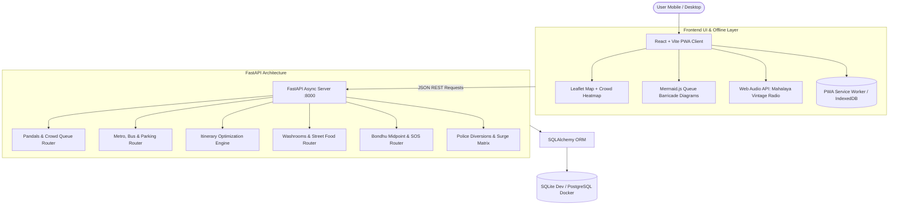

# Implementation Plan - "SharodUTSAV": Full-Stack Durga Puja Platform
*(Engineered for 2nd Year CSE B.Tech Portfolio & Hackathon Excellence)*

A production-grade, highly performant Durga Puja companion web application built with **React.js (Vite)**, **Tailwind CSS**, **Leaflet.js Heatmaps**, **Mermaid.js dynamic diagrams**, **FastAPI** with **SQLAlchemy ORM**, **PWA offline caching**, and **Docker containerization**.

---

## 1. Document Synthesis & Competitive Analysis Summary

Based on benchmarking against **Puja Bandhu** (Kolkata Police), **Bondhu**, **Pandal Explorer**, **Pujo Atlas Kolkata**, **DurgaPujaPass**, and **ThePuja.App**, this plan bridges the critical gap between **vision and real-world execution**:

| Critical Insight from Report | How this Plan Solves It |
| :--- | :--- |
| **No Source of Truth for Live Data** | Implements a **Crowdsourced Queue Reporter** ("Report Wait Time") with upvoting, verified tags, and **freshness timestamps** (*"Updated 6 mins ago"*). |
| **Network Jamming in Crowds (Section 5.7)** | **Offline-First PWA Mode** (`vite-plugin-pwa` + IndexedDB/localStorage): Saved itineraries, gate diagrams, and emergency contacts remain 100% accessible offline when 4G/5G drops near pandals. |
| **Trust & Police SOS Boundaries (Section 5.2)** | Friend SOS Radar is cleanly partitioned from state authorities: includes **1-Tap Direct Call to Dial 100 / Kolkata Police Helpline** and deep-links to the official Kolkata Police *Bondhu* portal. |
| **Scope Overload for Student Build (Section 5.3)** | Restructured into a **3-Phase Roadmap**: **MVP** (Core 4 modules + Heatmap + PWA), **V1.1** (Social & Amenities), **V2** (Transactions & Heritage 3D). |
| **Localization & Accessibility (Section 5.6)** | Bilingual UI toggle: **English** and **বাংলা (Bengali)**, high-contrast night mode for outdoor mobile viewing. |
| **'Wow' Visual Differentiators (Section 7)** | **Live Crowd Density Heatmap** (Leaflet canvas layer: Green / Amber / Red) and **Mermaid.js Queue Flowcharts** (barricades vs VIP lanes). |

---

## 2. Recommended Tech Stack for a 2nd Year CSE Student

### The Verdict: `React (Vite) + Tailwind CSS + FastAPI + SQLAlchemy + SQLite/PostgreSQL + Docker`

```
  ┌────────────────────────────────────────────────────────┐
  │                   CLIENT TIER (PWA)                    │
  │   React 18 (Vite) + Tailwind CSS + Lucide Icons        │
  │   Leaflet.js (Map & Heatmap) + Mermaid.js (Flowcharts) │
  │   Vite-PWA Service Worker (Offline Cache)              │
  └───────────────────────────┬────────────────────────────┘
                              │ REST JSON API (Axios / Fetch)
  ┌───────────────────────────▼────────────────────────────┐
  │                 BACKEND TIER (FastAPI)                 │
  │   FastAPI (Async Python 3.11, Uvicorn)                 │
  │   Pydantic V2 (Input Validation & Schemas)             │
  │   Auto-Generated Swagger Docs (/docs)                  │
  └───────────────────────────┬────────────────────────────┘
                              │ SQLAlchemy ORM
  ┌───────────────────────────▼────────────────────────────┐
  │                    DATABASE TIER                       │
  │   SQLite (Zero-config Dev) ➔ PostgreSQL (Prod/Docker) │
  └────────────────────────────────────────────────────────┘
```

### Why this is the Best Choice for a 2nd Year CSE Student:
1. **Resume & Interview Differentiation**:
   - Most 2nd-year students build generic MERN (MongoDB/Express) apps with no schema validation.
   - **FastAPI + SQLAlchemy + PostgreSQL** demonstrates understanding of **typed asynchronous Python**, **relational schema design (ACID/3NF)**, and **RESTful API contracts**—exact topics asked in SDE internship interviews and university DBMS courses.
2. **Self-Documenting API (`/docs`)**:
   - FastAPI generates interactive Swagger UI automatically. Perfect for demonstrating your backend endpoints live in college viva, project presentations, and hackathons without writing manual documentation.
3. **No Heavy Dev Overhead on Windows**:
   - Zero-config **SQLite** runs out of the box on Windows with zero background services.
   - When deploying or testing with Docker, switching to PostgreSQL requires changing only **one connection URL** in `.env` via SQLAlchemy.
4. **Offline Resilience (PWA)**:
   - Setting up `vite-plugin-pwa` allows you to claim *"Designed an offline-first resilient architecture for cellular-congested festival environments"* on your resume.

---

## 3. Phased Implementation Roadmap

### Phase 1: MVP Core (Weeks 1–3) — *Solve the Core Pandal-Hopping Pain*
- [x] **Pandal Directory & Gate Navigator**: 35+ verified Kolkata pandals (North, South, Central, Salt Lake) with General vs VIP vs Senior Citizen gate barricade paths.
- [x] **Dynamic Mermaid.js Queue Visualizer**: Interactive flow diagrams for barricades, metal detectors, and sanctum viewing paths.
- [x] **Crowdsourced Queue & Freshness Engine**: User wait-time submission with time-decay algorithm and status pills (*"Low: 15m", "Peak: 90m"*, *"Updated 7m ago"*).
- [x] **Transit & Parking Hub**: Nearest Metro stations, exit gate numbers (e.g. Kalighat Gate 3), night special bus routes, and official Kolkata Police parking lots.
- [x] **Smart Itinerary Optimizer**: Multi-pandal route planner factoring origin (Dum Dum, Garia, Howrah), transit preference, and time window.
- [x] **Live Crowd Heatmap**: Leaflet.js interactive map with color-coded crowd density overlays (Green/Amber/Red).
- [x] **Bilingual Toggle**: Seamless switch between English and Bengali (বাংলা).
- [x] **Offline PWA Shell**: Service worker caching for offline viewing of saved routes and emergency numbers.

### Phase 2: Social & Safety Expansion (Weeks 4–5) — *V1.1 Release*
- [x] **Bondhu Finder & Midpoint Engine**: Calculates fair central meeting hub (e.g., Central / Esplanade Metro) based on friends' locations.
- [x] **SOS & Emergency Beacon**: High-contrast strobe alarm, exact gate location beacon, plus **1-tap Dial 100 / Kolkata Police Bondhu App link**.
- [x] **Clean Washroom & Food Radar**: KMC Swachh public washrooms (cleanliness score + wheelchair tag) and iconic street food stalls (Arsalan, Nizam, Kusum).
- [x] **Indicative Traffic & Surge Matrix**: Police one-way diversions with realistic festive surge multipliers for Uber/Ola/Toto.

### Phase 3: Engagement & Polish (Week 6) — *V1.2 / Competition Ready*
- [x] **1980s Vintage Murphy Radio Simulator**: Web Audio API retro radio with rotary dial tuning into Birendra Krishna Bhadra’s Mahalaya broadcast.
- [x] **Insta Aesthetic Studio**: Photo spot guidance, posing catalog, and Bengali/Banglish caption copy generator.
- [x] **Post-Puja 'Wrapped' Card**: Shareable festival summary (pandals visited, kilometers walked) for Instagram/WhatsApp status.
- [x] **Car Rental & Driver Matching**: Budget and vehicle filter (Hatchback, Ertiga, Innova) with verified driver profiles.
- [x] **Pre-Pujo Shopping Authenticator**: Gariahat/Hatibagan guide + fake discount history tracker.

---

## 4. Architecture & Module Design



---

## 5. Detailed Module Specifications

### Module 1: Pandal Gate Navigator & Live Crowd Freshness
- **Gate Toggles**: General Line vs VIP Pass Corridor vs Senior Citizen Lane.
- **Dynamic Mermaid Flowchart**: Live SVG showing:
  `Entry Gate -> Barricade Zig-Zag -> Metal Detector Post -> Sanctum Mandap -> Exit Gate A/B`.
- **Crowdsourced Queue Updates**:
  - Endpoint: `POST /api/pandals/{id}/report-queue`
  - Payload: `{ wait_minutes: int, crowd_level: "low"|"moderate"|"heavy"|"packed" }`
  - Freshness timestamp display: `"Verified by 14 visitors (Updated 5m ago)"`.

### Module 2: Transit, Metro Gates & Police Parking
- **Metro Station Gate Guide**: North-South Blue line and East-West Green line exit gates closest to pandals with walking durations.
- **Police Designated Parking Zones**: 2-wheeler vs 4-wheeler capacity, hourly rates, and distance to pandal entrance.
- **All-Night Special Buses**: CSTC/CTC special night routes with route numbers and interchange hubs.

### Module 3: Parikrama Itinerary Optimizer
- Input: Origin location, available time window (e.g. 4 PM to 11 PM), mode of transport (Metro + Walk, Two-Wheeler, Car).
- Algorithm: Proximity clustering + one-way traffic constraint check to minimize back-tracking.
- Output: Time-stamped itinerary with transit steps, pandal viewing buffer, and route diagram.

### Module 4: Live Crowd Density Heatmap & Radar
- Full-screen interactive Leaflet.js map with custom festive markers (iconic Durga idol pins).
- Heatmap gradient overlay (Green = <30m wait, Amber = 30-60m wait, Red = 90m+ peak rush).
- Quick filter: "Near Metro", "VIP Lane Available", "Wheelchair Accessible".

### Module 5: Clean Washrooms & Iconic Kolkata Food Radar
- KMC Swachh Public Washroom directory with cleanliness rating and accessibility tags.
- Iconic Kolkata eateries (Kolkata Biryani, Kathi Rolls, Phuchka, Telebhaja, Mishti) with midnight opening indicators.

### Module 6: Bondhu Finder & Safe SOS Beacon
- **Rendezvous Midpoint**: Calculates lowest average travel-time Metro station for separated friends.
- **Emergency SOS Hub**:
  - High-visibility pulsating red strobe screen with loud siren sound.
  - Broadcasts exact pandal gate and GPS coordinates.
  - **Direct dial button for Dial 100 / Kolkata Police Control Room**.
  - Direct link to Kolkata Police *Bondhu* portal.

### Module 7: Live Police Diversions & Transport Surge Matrix
- Real-time road diversion alerts (e.g. Rashbehari Ave one-way toward Gariahat).
- Indicative fare surge multiplier matrix (Uber Moto, Yellow Taxi, Auto/Toto, Cab). Clearly marked as *Indicative festive estimates*.

### Module 8: Heritage Hub & 1980s Vintage Murphy Radio
- Nostalgic wooden vintage radio UI with glowing vacuum tubes and rotary frequency dial.
- Web Audio API realistic white noise static tuning physics.
- Plays iconic Birendra Krishna Bhadra Mahalaya recitation ("Mahisasuramardini").

### Module 9: Insta Aesthetic Studio & Caption Generator
- Curated photography angles and golden-hour lighting spots for top pandals.
- Posing guides (Dhunuchi dance pose, Rajbari courtyard candid).
- Bilingual Caption generator (English, বাংলা, Banglish) with 1-click clipboard copy.

### Module 10: PWA Offline-First Engine
- Service worker precaches application shell, pandal coordinates, Metro map, and emergency numbers.
- Works smoothly even in dead network zones around dense pandals.

---

## 6. Directory Structure

```
c:/Users/AVROJIT/OneDrive/Desktop/PUJO APP/
├── docker-compose.yml              # Single command startup for frontend & backend
├── README.md                       # Academic & developer documentation
├── backend/
│   ├── Dockerfile                  # Python 3.11 slim image
│   ├── requirements.txt            # fastapi, uvicorn, sqlalchemy, pydantic, etc.
│   ├── main.py                     # FastAPI entry point, CORS, exception handlers
│   ├── database.py                 # SQLAlchemy engine and session factory
│   ├── models.py                   # Relational DB models (Pandal, Gate, QueueReport, Transit, Amenity)
│   ├── schemas.py                  # Pydantic request/response schemas
│   ├── seed_data.py                # 35+ verified Kolkata pandals & civic amenities
│   └── routers/
│       ├── pandals.py              # Gate navigation, queue reporting & freshness
│       ├── transit.py              # Metro exit gates, night buses & parking
│       ├── itinerary.py            # Route optimization engine
│       ├── amenities.py            # Clean washrooms & food stalls
│       ├── groups.py               # Bondhu finder, midpoint calculator & SOS
│       ├── traffic.py              # Police diversions & indicative surge fares
│       └── heritage.py             # Radio, Mahalaya & cultural assets
└── frontend/
    ├── Dockerfile                  # Node 18 Alpine multi-stage Nginx build
    ├── package.json                # React, Tailwind, Leaflet, Mermaid, Lucide
    ├── vite.config.js              # Vite config with PWA plugin & API proxy
    ├── tailwind.config.js          # Sindoor Red, Marigold Gold, Royal Navy palette
    ├── index.html                  # Bengali fonts (Anek Bangla / Outfit) & PWA meta
    └── src/
        ├── index.css               # Tailwind directives + festive glassmorphism
        ├── App.jsx                 # Master layout, navbar, tab routing & offline banner
        ├── context/
        │   └── LanguageContext.jsx # Bilingual toggle (EN / বাংলা)
        └── components/
            ├── LiveHeatmap.jsx     # Leaflet map with crowd heatmap layer
            ├── MermaidViewer.jsx   # Dynamic queue barricade diagram renderer
            ├── PandalGateNav.jsx   # Gates, VIP vs General line, wait time reporting
            ├── TransitGuide.jsx    # Metro gates, night buses & parking lots
            ├── ItineraryPlanner.jsx# Parikrama schedule generator
            ├── AmenitiesRadar.jsx  # Swachh washrooms & midnight food stalls
            ├── BondhuSOS.jsx       # Group midpoint calculator & Police SOS beacon
            ├── TrafficSurge.jsx    # Police diversions & transport fare matrix
            ├── VintageRadio.jsx    # 80s Murphy Radio dial with Web Audio static
            ├── InstaStudio.jsx     # Aesthetic posing guide & Bengali captions
            └── OfflineNotice.jsx   # Offline connection status pill
```

---

## 7. Verification & Testing Plan

### Automated API Verification:
```bash
# 1. Health Check
curl http://localhost:8000/api/health

# 2. Fetch Pandals with Live Queue Stats
curl http://localhost:8000/api/pandals/

# 3. Submit Crowdsourced Queue Report
curl -X POST http://localhost:8000/api/pandals/1/report-queue \
  -H "Content-Type: application/json" \
  -d '{"wait_minutes": 35, "crowd_level": "moderate"}'

# 4. Generate Optimized Itinerary
curl -X POST http://localhost:8000/api/itinerary/plan \
  -H "Content-Type: application/json" \
  -d '{"origin":"Dum Dum","start_time":"16:00","end_time":"23:00","mode":"metro"}'
```

### Manual & UI Testing:
1. **Queue Reporting**: Submit a crowd report on a pandal; verify the wait time immediately updates with an *"Updated a few seconds ago"* badge.
2. **Mermaid Barricade Diagram**: Switch between General and VIP gates; verify the flowchart recalculates node connections without rendering errors.
3. **Heatmap & Filters**: Click "Near Metro" or "Low Wait"; verify the Leaflet map updates marker clusters and crowd circles.
4. **Offline Resilience**: Open Chrome DevTools -> Network -> Select **Offline**; verify the app still loads pandal listings, cached diagrams, and emergency contact numbers.
5. **Language Switcher**: Toggle between English and Bengali; verify all navigation labels and pandal details switch seamlessly.
6. **SOS Beacon**: Press Emergency SOS; verify high-contrast alarm screen triggers with direct 1-tap call to **Dial 100**.
